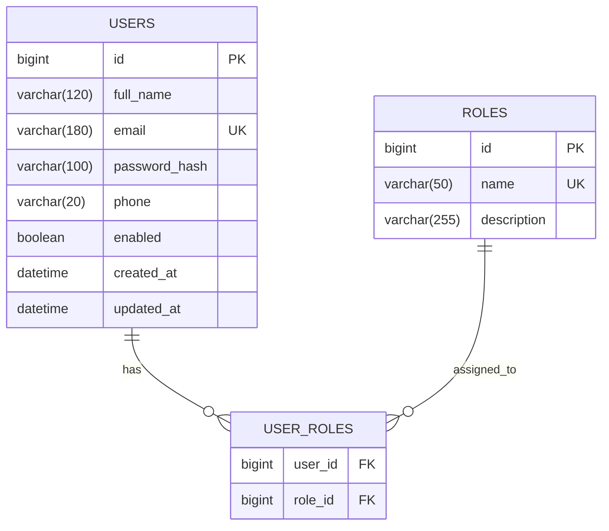
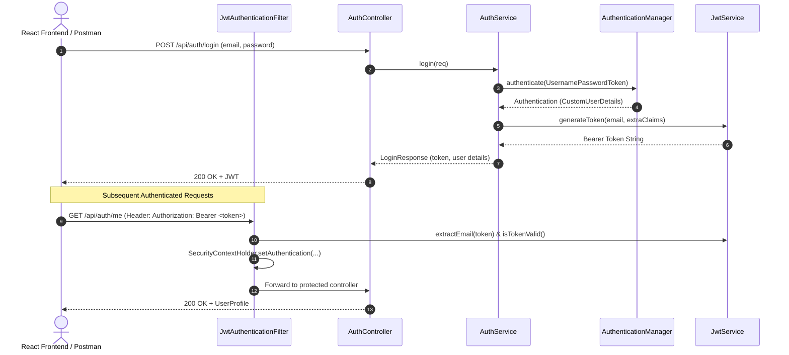

# MediStock — Clinical Platform API Architecture & Documentation

## 1. System Overview & Technology Stack
- **Framework**: Spring Boot 3.3.4 (Java 21 / 25 compatible)
- **Security Engine**: Spring Security 6, Stateless JWT (JJWT 0.12.6, HMAC-SHA256)
- **Persistence**: Spring Data JPA, Hibernate ORM 6.5, HikariCP
- **Database**: MySQL 8.x (production/dev) with H2 in-memory (test suite)
- **Frontend Architecture**: React 18, Vite, React Router 6, Tailwind CSS

---

## 2. MySQL Schema & Entity Relationships



### Table Definitions & Constraints
1. **`users` Table**:
   - `id`: Primary Key (AUTO_INCREMENT).
   - `email`: Unique constraint (`uk_users_email`), non-null, indexed for quick lookup.
   - `password_hash`: Stores BCrypt hash (strength 10), never plaintext.
   - `enabled`: Boolean active account flag.
   - `created_at` / `updated_at`: Automated Hibernate auditing timestamps.
2. **`roles` Table**:
   - Roles seeded by [`DataSeeder.java`](file:///e:/medistock/medistock-backend-main/src/main/java/com/medistock/medistock_backend/config/DataSeeder.java):
     - `ROLE_ADMIN`: Full system administration and audit trail access.
     - `ROLE_PHARMACIST`: Formulary management, lot inspection, stock adjustments.
     - `ROLE_STAFF`: Day-to-day dispensing and requisition intake.
     - `ROLE_SUPPLIER`: External distributor intake and cold-chain logging.
3. **`user_roles` Join Table**:
   - Many-to-Many mapping with foreign keys pointing to `users(id)` and `roles(id)`.

---

## 3. Security Architecture & JWT Flow



---

## 4. REST Endpoints Specification

### 4.1 Authenticate & Obtain Token
- **Endpoint**: `POST /api/auth/login`
- **Access**: Public
- **Request Headers**: `Content-Type: application/json`
- **Request Body**:
```json
{
  "email": "admin@medistock.local",
  "password": "ChangeMe!123"
}
```
- **Responses**:
  - `200 OK`:
    ```json
    {
      "token": "eyJhbGciOiJIUzI1NiIsInR5cCI6IkpXVCJ9...",
      "tokenType": "Bearer",
      "expiresInMs": 900000,
      "user": {
        "id": 1,
        "fullName": "System Administrator",
        "email": "admin@medistock.local",
        "phone": null,
        "enabled": true,
        "roles": ["ROLE_ADMIN"]
      }
    }
    ```
  - `400 Bad Request`: Validation failure (empty email or password).
  - `401 Unauthorized`: `"Invalid email or password"`.

### 4.2 Get Current User Profile
- **Endpoint**: `GET /api/auth/me`
- **Access**: Authenticated (`ROLE_ADMIN`, `ROLE_PHARMACIST`, `ROLE_STAFF`, `ROLE_SUPPLIER`)
- **Request Headers**: `Authorization: Bearer <JWT>`
- **Response**:
  - `200 OK`:
    ```json
    {
      "id": 1,
      "fullName": "System Administrator",
      "email": "admin@medistock.local",
      "phone": null,
      "enabled": true,
      "roles": ["ROLE_ADMIN"]
    }
    ```
  - `401 / 403`: Missing or expired JWT token.

---

## 5. Postman Collection
Import [`medistock_postman_collection.json`](file:///e:/medistock/medistock-backend-main/medistock_postman_collection.json) directly into Postman.
- Features automatic extraction of `{{jwt_token}}` from the login response.
- Includes pre-built test assertions for HTTP 200, 400, and 401 response cases.

---

## 6. Running Tests
Execute the automated test suite in the backend directory:
```powershell
cd e:\medistock\medistock-backend-main
.\mvnw.cmd test
```
All 14 tests across [`JwtServiceTest`](file:///e:/medistock/medistock-backend-main/src/test/java/com/medistock/medistock_backend/security/JwtServiceTest.java), [`AuthServiceTest`](file:///e:/medistock/medistock-backend-main/src/test/java/com/medistock/medistock_backend/service/AuthServiceTest.java), and [`AuthControllerTest`](file:///e:/medistock/medistock-backend-main/src/test/java/com/medistock/medistock_backend/controller/AuthControllerTest.java) run using the embedded test database and pass with 0 errors.
